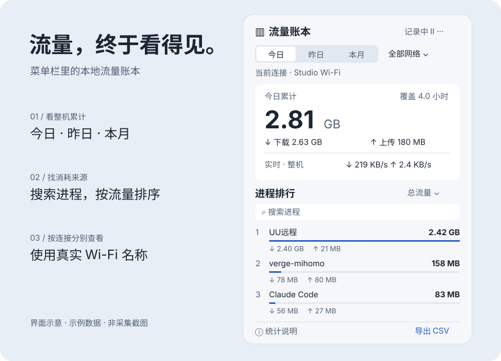

# 流量喵 · FlowCat

一个原生 macOS 菜单栏流量工具。点击菜单栏，查看整机流量和进程排行，帮助了解手机热点、远程桌面与日常开发的流量消耗。

**macOS 13+ · Apple Silicon · Swift / SwiftUI · MIT**

[下载最新版](https://github.com/tab16360/flowcat/releases/latest) · [介绍站点](https://tab16360.github.io/flowcat/) · [使用说明](docs/guide.md) · [更新记录](CHANGELOG.md)



*上图为界面示意，使用示例数据，并非实际采集截图。*

## 能做什么

| 功能 | 说明 |
| --- | --- |
| 菜单栏实时速度 | 随时查看整机下载速度，点击展开统计 |
| 今日／昨日／本月 | 查看各时段整机收发总量与采集覆盖时间 |
| 进程排行 | 合并可识别的 App 辅助进程；支持搜索与总量、下载、上传排序 |
| 按 Wi-Fi 筛选 | 使用真实 SSID；不能识别或拒绝权限时仅显示全部网络 |
| 本地记录 | JSON 持久化，可导出 CSV；无需账号、不上传数据、不记录通信内容 |
| 右键快捷控制 | 菜单栏图标右键或 Control 点击，打开面板、暂停／继续、登录启动、导出和退出 |
| 持续运行 | 暂停／继续、登录启动、睡眠恢复后重新建立计数基线 |


## 资源占用

1.3.4 优化后台常驻：统计面板点击时才创建，关闭后释放；应用图标只在列表显示时加载，缩为 64×64 像素、最多缓存 64 个，关闭面板后清空；每轮后台采样及时释放临时对象。

**物理内存与 RSS 是不同口径。** 本次后台观察，优化版的 `vmmap` Physical footprint 约 36 MB，旧版重启后约 38–43 MB；新版 RSS 仍约 119 MiB。降幅较小，且测量阶段不同，不构成严格性能基准。SwiftUI 与系统共享映射不会因为释放面板而全部卸载。面板开关循环仍待现场验收。

下面保留 1.3.3 的历史测量作为参考，不代表 1.3.4 的完整基准。

**原生菜单栏应用，采用低频采样，让后台开销保持较低。** 每 10 秒读取一次系统计数，每分钟保存历史；不内嵌浏览器，也不抓取通信内容。

2026-10-10 在 Apple M1、macOS 26.5.2 上对 1.3.3 的一次 60 秒运行测量：

| 项目 | 本次结果 |
| --- | --- |
| 主进程平均 CPU | 约 0.69%（以单核 100% 为基准） |
| 采样命令平均 CPU 估算 | 约 0.75%；单独运行 3 轮命令，按每 10 秒一次折算 |
| 合计平均 CPU 估算 | 约 1.4%，不是主进程与子进程同时追踪的完整基准测试 |
| 主进程常驻内存（RSS） | 约 103–107 MiB，不包含采样子进程 |
| 应用体积 | 约 1 MiB；安装 ZIP 约 251 KiB，不包含历史数据 |

这是当前机器与运行状态的短时测量，不保证所有机器都相同。活跃连接、进程数、面板交互和历史数据量会影响开销；历史文件会随使用增长。CPU 占用较低，但内存不是“只有几 MB”。[测量方法与边界](docs/performance.md)。

## 安装

1. 从 [Releases](https://github.com/tab16360/flowcat/releases/latest) 下载 `FlowCat-版本-arm64.zip`。
2. 解压，将 `流量喵.app` 拖入“应用程序”，双击启动。
3. 点击菜单栏图标。首次运行约 10 秒用于建立基线；“更多”菜单可设置登录启动。
4. 无法读取 Wi-Fi 名称时会请求系统定位权限。你可以拒绝，统计仍在全部网络下进行，应用不会请求位置坐标。

应用当前为临时签名、未公证。macOS 可能阻止首次打开；确认来源后按系统设置“隐私与安全性”的提示允许打开，不需要关闭系统安全功能。升级前退出旧版，再替换应用。

历史保存在 `~/Library/Application Support/流量账本/ledger.json`。替换应用不会删除历史，卸载时先关闭登录启动并退出。详细说明见 [使用指南](docs/guide.md)。

## 怎样理解数字

**整机总量**使用 `en*` 物理网络接口计数，排除回环与 VPN 虚拟接口。包含局域网和协议开销；多网卡活动会汇总，不能替代运营商账单。

**进程排行**来自 `nettop`。代理、VPN 可能包含其他进程转发的相同流量，因此不要把排行各行相加作为整机总量。

仅统计应用运行且未暂停的时段，不能恢复过去的流量。10 秒采样，每分钟保存；短时进程、睡眠、网络切换和计数器重置可能漏计。网络切换间隔跳过，多物理网卡同时活跃仅计入全部网络。

## 从源码构建

需要 macOS 13+ 和 Xcode Command Line Tools，不需要 Node、pnpm 或第三方库。

```sh
git clone https://github.com/tab16360/flowcat.git
cd flowcat
bash scripts/test.sh
bash scripts/build.sh
open build/流量喵.app
```

构建默认 arm64；可使用 `ARCH=x86_64 bash scripts/build.sh` 尝试 Intel 构建，当前未进行 Intel 运行验收。创建发布包：

```sh
bash scripts/package.sh
# 输出 dist/FlowCat-1.3.4-arm64.zip 及其 SHA-256
```

## 项目结构

```text
Sources/       SwiftUI 界面、采样、SSID 识别与统计核心
Tests/         核心统计回归检查
scripts/       构建、检查、打包和发布
Info.plist     应用身份、版本与权限说明
docs/          静态介绍站点、图示与使用指南
.github/       CI、GitHub Pages 与 tag Release 工作流
```

本地预览介绍页：`python3 -m http.server 8080 --directory docs`，访问 `http://localhost:8080`。页面不使用第三方 CDN、跟踪器或外部字体。

## 发布与维护

CI 检查核心统计并生成安装包。`main` 上的站点更新由 GitHub Pages 工作流发布。发布前更新 `Info.plist`、`CHANGELOG.md` 和 `RELEASE_NOTES.md`，然后推送与版本一致的 `vX.Y.Z` 标签；Release 工作流验证、打包并上传 ZIP 与校验文件。

完整发布步骤见 [发布指南](docs/releasing.md)，参与开发见 [CONTRIBUTING](CONTRIBUTING.md)。

## 验证状态

1.3.4 本机构建与签名检查通过，30 项核心统计检查通过。本机采样进程已运行并用于资源观察；图形自动化未获该应用访问权限，完整菜单栏交互、权限弹窗和面板开关循环尚未验收。图示不能替代运行测试。

采用 [MIT 许可证](LICENSE)。
